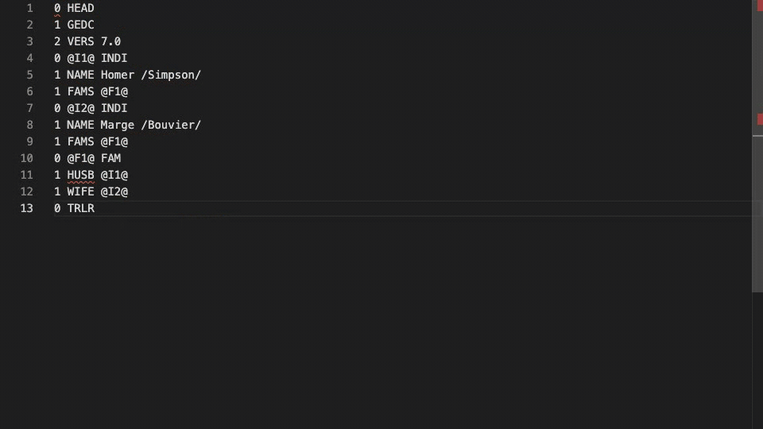

# GEDCOM for Visual Studio Code

GEDCOM language support by Domorium. Read and edit `.ged` and `.gedcom` files
with confidence using structure-aware suggestions and diagnostics as you type.



## Features

- Context-aware GEDCOM autocomplete
- Real-time structural validation
- Syntax highlighting from the moment a file opens, refined by the language
  server once it connects
- GEDCOM highlighted inside a `gedcom` code block in Markdown
- Hover information for GEDCOM tags
- Go to definition for cross-references
- Find all XREF references with read/write highlights
- Safe, atomic XREF rename
- Clickable web and local-file links
- Media links that follow a file renamed or moved in the editor
- Quick fixes for broken references and invalid levels
- Code folding for records and nested structures
- Support for `.ged` and `.gedcom` files

## Highlighting

Each part of a line is coloured for what it is — the level, the tag, the record an
XREF declares, a reference to one, and the value:

```gedcom
0 @I1@ INDI
1 NAME John /Doe/
1 SEX M
1 BIRT
2 DATE 1 JAN 1900
1 FAMS @F1@
```

The colours come from your theme, and two layers produce them. A grammar paints
the file as soon as it opens, and works in a Markdown code block like the one
above, where no language server can reach. The language server then refines the
same colours with what it knows that a grammar cannot — which XREF declares a
record and which refers to one. The two agree, so nothing changes appearance when
the server connects.

## Renaming a media file

Rename or move a photograph in the Explorer, and every open GEDCOM document that
names it by a relative path is rewritten as part of the rename. A GEDCOM 7
document cannot name a file above its own folder, so a move there leaves it
unchanged and a warning names it. GEDCOM files that are not open are not
rewritten: if a line of one of them ends in the file's name, a warning names them.
That is a search by name, not a reading of the file, so it can name a file whose
note ends in the name, and it misses a path split across `CONC` lines, a name in
other letter case, and anything under `node_modules`.

Not followed: renaming a folder, renaming outside the editor (git, a terminal,
another program), absolute paths such as `C:\photos\a.jpg` or `file:///…`, and a
workspace whose GEDCOM files have a mixed-case extension such as `.Ged`.

## Installation

Install [GEDCOM from the Visual Studio Marketplace](https://marketplace.visualstudio.com/items?itemName=domorium.gedcom), or run:

```bash
code --install-extension domorium.gedcom
```

You can also [try the GEDCOM web editor by Domorium](https://domorium.com/editor/).

## Contributing

See the [project repository](https://github.com/lavich/domorium) for development setup and contribution instructions.

## License

MIT © 2025 Andrei Lobanov

Domorium is an independent project and is not affiliated with or endorsed by
FamilySearch or Intellectual Reserve, Inc. FAMILYSEARCH GEDCOM™ and FAMILYSEARCH®
are trademarks of Intellectual Reserve, Inc.
